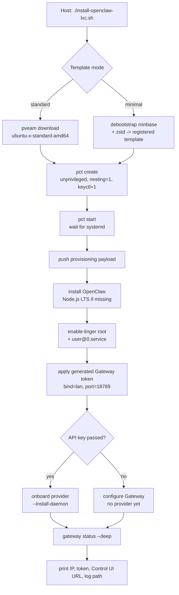

<div align="center">

# OpenClaw on Proxmox LXC

**One script. A clean Ubuntu container. A self-hosted OpenClaw Gateway — running as a systemd user service that survives reboots.**


[Quick Start](#quick-start) &nbsp;•&nbsp; [What You Get](#what-you-get) &nbsp;•&nbsp; [Options](#configuration-reference) &nbsp;•&nbsp; [Security](#security-posture) &nbsp;•&nbsp; [Troubleshooting](#troubleshooting)

</div>

---

`install-openclaw-lxc.sh` provisions an **Ubuntu LXC container** on **Proxmox VE** and installs **[OpenClaw](https://openclaw.ai/)** inside it, then wires the **Gateway** up as a systemd **user** service with lingering enabled — so it comes back automatically after every reboot.

No manual `apt` dances. No half-configured units. No dozen-tab README.

---

## Why use this?

- **One command, end to end** — template download, container creation, OpenClaw install, Gateway service, and a readiness check, all in one run.
- **Two rootfs flavors** — grab the official Proxmox Ubuntu template, or build a lean `debootstrap` rootfs with `--minimal`.
- **Nothing on your host** — in standard mode the host only runs `pct`/`pveam`; everything else lives inside the container. (`--minimal` installs `debootstrap` on the host, then cleans up after itself.)
- **Survives reboots** — `loginctl enable-linger root` + `user@0.service`, so the Gateway starts before you ever log in.
- **Hands-off setup** — the script generates a Gateway auth token, enables LAN binding by default, and installs the daemon. Pass an Anthropic or OpenAI key to configure a provider at the same time.
- **Docker-ready** — created unprivileged with `nesting=1,keyctl=1`, so you can still run Docker sandboxes inside the container later.
- **Smart defaults, full control** — auto-detects bridge, storage, VMID, and architecture; override any of it with a flag.
- **Safe to rehearse** — `--dry-run` prints the exact plan without touching your cluster, and every run writes a full log.
- **Fail-safe** — `--destroy-on-failure` cleans up a broken container; without it, the container is kept for debugging.

---

## How it works



<details>
<summary><strong>Step-by-step, in words</strong></summary>

1. **Preflight** — verifies `pct`, `pveam`, `pvesm`, `pvesh`, and `/etc/pve`, and that you are root.
2. **Detect** — picks the next free VMID, a `rootdir` storage, a `vztmpl` storage, the first `vmbr*` bridge, and the host architecture (`amd64`/`arm64`).
3. **Prepare rootfs** — either downloads the newest `ubuntu-<ver>-standard` template, or debootstraps a `minbase` rootfs, strips docs/man/apt caches, blanks `/etc/machine-id`, and packs it to `.tar.zst`.
4. **Create the container** — `pct create` unprivileged, `nesting=1,keyctl=1`, `onboot=1`, host timezone, `openclaw` tag.
5. **Boot and wait** — polls until `systemctl is-system-running` reports `running` or `degraded`, then reads `eth0`'s IPv4.
6. **Provision** — pushes `openclaw-provision.sh` plus a `0600` env file into the container, runs it, then deletes the env file.
7. **Install** — `apt update && upgrade`, base packages, the official OpenClaw installer, linger + `user@0.service`, non-interactive Gateway setup with the host-generated token, optional provider onboarding, then `openclaw gateway status --deep`.
8. **Report** — prints container IP, Gateway token, Control UI URL, log path, SSH tunnel hint, and next steps.

</details>

---

## Quick Start

SSH into your **Proxmox host** and run:

```bash
bash <(curl -fsSL https://raw.githubusercontent.com/SonVu/proxmox-openclaw-lxc/main/install-openclaw-lxc.sh)
```

That's it. The script asks nothing unless it has to, picks sensible defaults, and prints your container IP, Control UI URL, and log path at the end.

### Alternative install methods

**Download first, then run:**

```bash
curl -fsSLO https://raw.githubusercontent.com/SonVu/proxmox-openclaw-lxc/main/install-openclaw-lxc.sh
chmod +x install-openclaw-lxc.sh
./install-openclaw-lxc.sh
```

**Clone the repo:**

```bash
git clone https://github.com/SonVu/proxmox-openclaw-lxc.git
cd proxmox-openclaw-lxc
chmod +x install-openclaw-lxc.sh
./install-openclaw-lxc.sh
```

**Rehearse before you commit:**

```bash
./install-openclaw-lxc.sh --dry-run
```

---

## What you get

After the script finishes:

| What | How to reach it |
|------|-----------------|
| **OpenClaw Control UI** | `http://<container-ip>:18789` — the installer prints the auth token at the end; `openclaw dashboard` prints it again |
| **Container shell** | `pct enter <ctid>` from the host |
| **SSH** | `ssh root@<container-ip>` — `openssh-server` is installed and enabled |
| **Gateway service** | `openclaw gateway status --deep` (systemd **user** unit, lingering enabled) |
| **Full log** | `/var/log/openclaw-lxc-<timestamp>.log` on the host |

> The Control UI always requires an auth token. The installer generates one automatically; `--bind lan` makes the Gateway listen on all interfaces **inside** the container; the token is what protects it. See [Security posture](#security-posture).

---

## Requirements

| Requirement | Notes |
|-------------|-------|
| **Proxmox VE 8.x / 9.x** | Must have `pct`, `pveam`, `pvesm`, `pvesh`, and `/etc/pve` |
| **Root on the host** | Run the script directly on the Proxmox host — never inside a container |
| **`rootdir` storage** | Any active storage with `rootdir` content (`lvmthin`, `zfspool`, `btrfs`, `dir`) |
| **`vztmpl` storage** | Any active storage with `vztmpl` content (`dir`, `nfs`, `cifs`, `cephfs`) |
| **`--minimal` only** | Needs a `dir`/NFS/CIFS `vztmpl` storage (it writes the `.tar.zst` directly), plus host packages `debootstrap`, `ubuntu-keyring`, `zstd` (installed automatically) |
| **Internet access** | To download the template, Ubuntu packages, Node.js, and OpenClaw |

---

## Configuration reference

Every flag is optional — the script auto-detects the rest. Run `./install-openclaw-lxc.sh --help` for the same list on the host.

### Container

| Option | Default | Description |
|--------|---------|-------------|
| `--ctid <id>` | next free ID | Container VMID |
| `--hostname <name>` | `openclaw` | Container hostname |
| `--cores <n>` | `2` | vCPU count |
| `--memory <mb>` | `4096` | RAM in MB — **minimum 2048** (Gateway needs ≥ 2 GB heap) |
| `--swap <mb>` | `512` | Swap in MB |
| `--disk <gb>` | `16` | Root filesystem size in GB — **minimum 8** |
| `--storage <id>` | auto-detect | Storage for the container rootfs |

### Networking & access

| Option | Default | Description |
|--------|---------|-------------|
| `--bridge <vmbr>` | first `vmbr*` found | Network bridge |
| `--ip <dhcp\|CIDR>` | `dhcp` | `eth0` address — e.g. `192.168.1.50/24` |
| `--gw <ip>` | — | Gateway — **required** when `--ip` is a CIDR |
| `--nameserver <ip>` | from host | DNS for the container |
| `--password <pass>` | prompted | Root password; prompted securely when omitted (mutually exclusive with `--ssh-key`) |
| `--ssh-key <file>` | unset | Path to a **public** key to authorize for root (mutually exclusive with `--password`) |

### Ubuntu / template

| Option | Default | Description |
|--------|---------|-------------|
| `--ubuntu <ver>` | `24.04` | Ubuntu release (`22.04`, `24.04`, `24.10`, `25.04`, `25.10`) |
| `--ubuntu-codename <c>` | inferred | Codename for `--minimal` — e.g. `noble`, `jammy` |
| `--minimal` | off | Build the rootfs with `debootstrap` instead of the standard template |
| `--mirror <url>` | per-arch default | Mirror used by `debootstrap` |
| `--template-storage <id>` | auto-detect | Storage for the template |

### OpenClaw

| Option | Default | Description |
|--------|---------|-------------|
| `--skip-openclaw` | off | Create the container only, skip the OpenClaw install |
| `--bind <mode>` | `lan` | `gateway.bind`: `loopback` \| `lan` \| `tailnet` \| `custom` \| `auto` |
| `--port <port>` | `18789` | Gateway port |
| `--gateway-token <token>` | auto-generated | Gateway auth token; must be at least 24 characters when supplied |
| `--anthropic-key <key>` | — | Non-interactive onboarding with an Anthropic API key |
| `--openai-key <key>` | — | Non-interactive onboarding with an OpenAI API key |
| `--onboard-extra "<args>"` | — | Extra arguments passed straight through to `openclaw onboard` |

### Behavior

| Option | Default | Description |
|--------|---------|-------------|
| `--dry-run` | off | Print the plan and exit — creates nothing |
| `--destroy-on-failure` | off | Destroy the container if provisioning fails |
| `--log <file>` | `/var/log/openclaw-lxc-<time>.log` | Full log path (falls back to `/tmp` if unwritable) |
| `-h`, `--help` | — | Show usage |

---

## Usage examples

### Defaults — Ubuntu 24.04, DHCP, 4 GB RAM, 16 GB disk

```bash
./install-openclaw-lxc.sh
```

### Trimmed-down rootfs built with `debootstrap`

Smaller and cleaner than the stock template, but caches nothing — expect **5–15 minutes**.

```bash
./install-openclaw-lxc.sh --minimal \
  --ctid 210 --hostname claw \
  --memory 6144 --cores 4 --disk 24 \
  --ip 192.168.1.50/24 --gw 192.168.1.1
```

### Install **and** configure an AI provider, no prompts

```bash
./install-openclaw-lxc.sh --anthropic-key "$ANTHROPIC_API_KEY" --bind lan
# or
./install-openclaw-lxc.sh --openai-key "$OPENAI_API_KEY" --bind lan
```

Omit the key and the script still configures the Gateway (`bind=lan`, token auth) and installs the daemon. Run `openclaw configure` inside the container afterwards to add an AI provider.

### Loopback-only Gateway (reach it through an SSH tunnel)

```bash
./install-openclaw-lxc.sh --bind loopback
ssh -N -L 18789:127.0.0.1:18789 root@<container-ip>
```

### Container only, no OpenClaw

```bash
./install-openclaw-lxc.sh --skip-openclaw --hostname sandbox
```

---

## After install

```bash
pct enter 210                          # enter the container
openclaw configure                     # configure a provider (if no key was passed)
openclaw dashboard                     # print the Control UI URL + auth token
openclaw gateway status --deep         # health check
openclaw doctor                        # broader diagnostics
```

If `systemctl --user` complains about a missing bus — common with `pct enter`, which creates no PAM session — export it once in your current shell:

```bash
export XDG_RUNTIME_DIR=/run/user/0
```

The script already writes `/etc/profile.d/openclaw-xdg.sh` and appends it to `/root/.bashrc`, so **new** shells get this for free.

---

## Container management

```bash
pct list                         # list containers
pct status 210                   # status
pct start 210                    # start
pct stop 210                     # stop
pct enter 210                    # root shell
pct exec 210 -- systemctl --user status openclaw-gateway
```

### Uninstall

```bash
pct stop 210 && pct destroy 210 --purge
```

---

## Security posture

- **`--bind lan`** makes the Gateway listen on every interface inside the container. The Gateway **refuses to start** on a non-loopback address without an auth token — the installer generates one automatically and prints it in the final summary.
- **Prefer `--bind loopback`** for anything beyond a trusted LAN, then reach the UI through an SSH tunnel or Tailscale Serve:

  ```bash
  ssh -N -L 18789:127.0.0.1:18789 root@<container-ip>
  ```

- **The container is an unprivileged LXC**, not a VM. Its isolation boundary is not the same as virtualization. Do not expose it directly to the internet — restrict access with a firewall rule on the host.
- **Secrets** — the provisioning env file is pushed with mode `0600` and removed immediately after the script runs. API keys never touch the host log.

---

## Troubleshooting

| Symptom | Fix |
|---------|-----|
| `No template 'ubuntu-...-standard' found` | `pveam update`, then re-run — or switch to `--minimal` |
| Container has no IPv4 | `pct exec <id> -- ip a` — check the bridge/DHCP, or set a static `--ip`/`--gw` |
| Gateway does not start after a reboot | `pct exec <id> -- loginctl show-user root` must report `Linger=yes` |
| `openclaw: command not found` | `pct enter <id>`, then `hash -r`; verify `npm prefix -g` is `/usr` |
| `systemctl --user` fails: no bus | `export XDG_RUNTIME_DIR=/run/user/0` in the current shell |
| Non-interactive onboarding failed | Run `openclaw onboard` interactively inside the container — the CLI is already installed |
| `--minimal` cannot resolve the template path | The `vztmpl` storage must be `dir`/NFS/CIFS, not `lvmthin`/`zfspool` |
| Start over cleanly | `pct stop <id> && pct destroy <id> --purge` |

Always check the full log first: `/var/log/openclaw-lxc-<timestamp>.log`.

---

## Technical notes

- **Official installer, not `npm i -g`.** The OpenClaw installer pins the correct current Node.js LTS and handles `--allow-scripts` semantics that vary between npm releases.
- **`ifupdown` + `isc-dhcp-client` are intentional in `--minimal`.** Proxmox writes guest networking to `/etc/network/interfaces` and expects the guest to bring interfaces up. Without both packages, a minimal container boots with no network at all.
- **`/etc/machine-id` is blanked** in the minimal rootfs so systemd generates a unique ID per container.
- **`nesting=1,keyctl=1`** are enabled up front so Docker works inside the LXC if you need a sandbox later.
- **storage detection has a fallback** — if `pvesm status` returns nothing, the script parses `/etc/pve/storage.cfg` directly.
- **The LXC root password never reaches the log** — it is prompted securely and `pct create` arguments are redacted before logging.
- **The Gateway token is generated locally** — pass `--gateway-token` to use your own value instead of the random 48-character token.
- **Review before you run** — `--dry-run` prints the full `pct create` invocation (with the password redacted) so you can inspect it before anything is created. The script passes `bash -n` and `shellcheck`.

---

## Repository layout

```text
proxmox-openclaw-lxc/
├── install-openclaw-lxc.sh   # host-side orchestrator + in-container provisioning payload
└── README.md
```

The installer is a single self-contained file: the container-side provisioning script is embedded as a quoted heredoc and pushed to `/root/openclaw-provision.sh` at runtime.

---

## License

MIT
